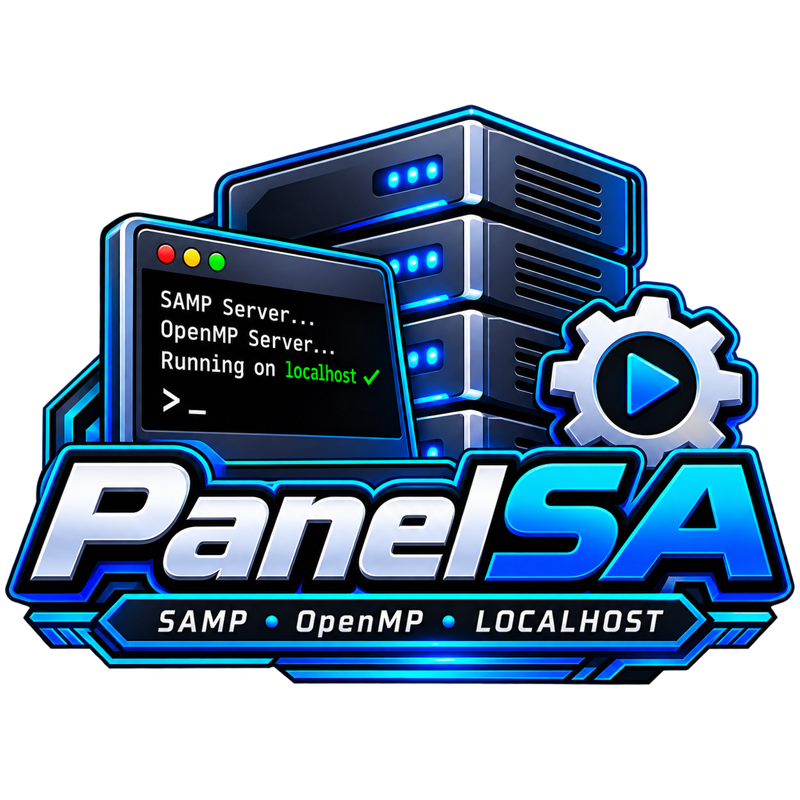

SAMP & OpenMP Server Management Panel

Manage Your Server. Your Way.

---

🚀 About PanelSA

PanelSA is a server management project designed for managing SA-MP and OpenMP servers through a modern and convenient interface.

Built with a focus on simplicity, performance, and usability.

✨ Features

- 🖥️ SAMP Server Management
- ⚙️ OpenMP Server Management
- 🌐 Localhost Server Support
- 🚀 Server Control
- 📊 Server Information
- 🎨 Modern User Interface

📸 Screenshots

Coming Soon...

📋 Project Information

Information| Details
Project| PanelSA
Category| Server Management
Platform| Android
Supported Server| SA-MP / OpenMP
Version| 1.0.0
Developer| ZafarRY
License| Proprietary

📜 License & Copyright

Copyright © 2026 ZafarRY. All Rights Reserved.

PanelSA is proprietary software.

Unauthorized copying, modification, redistribution, or commercial use without permission from the copyright owner is prohibited.

---

PANELSA

SAMP • OpenMP • LOCALHOST

Developed with ❤️ by ZafarRY

© 2026 All Rights Reserved.

